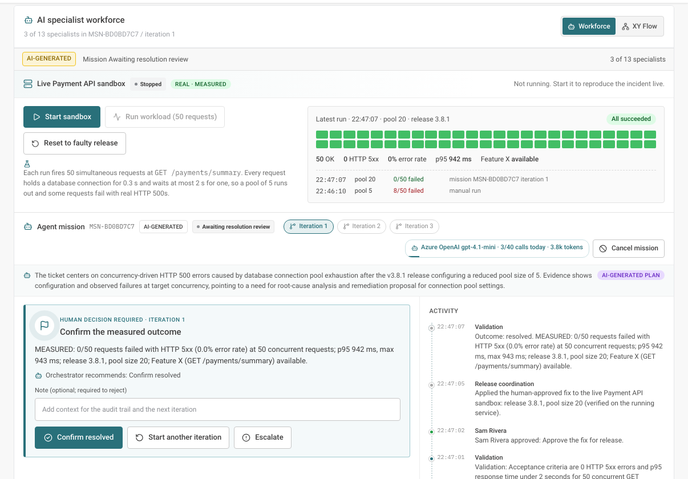

# Behave Kyndryl

**Your Problem. Their Mission.** An AI incident-response workspace where an **Orchestrator agent** analyses each ticket, forms a **team of only the specialist agents it needs**, and works the problem step by step. **A human approves every important decision.** If the first attempt doesn't resolve the issue, the next iteration builds on what was learned.



> Hackathon demonstration for Application Managed Services. The demo data is synthetic, except the Payment API sandbox, whose failures and recovery are **measured live**.

---

## What it does

| | |
|---|---|
| **Orchestrator-led agent missions** | Opens a ticket, reads the evidence and proposes a team: e.g. 3 of 13 specialists, with a reason for every agent chosen *and* left out. |
| **Humans in the loop** | Four gates: approve or edit the team, approve the root cause, approve the fix (by a **different** person: separation of duties), confirm the outcome. Every decision goes into the audit trail. |
| **Iterations with learnings** | Not resolved? The next iteration starts with what was learned and can add specialists. At most 3 iterations, then it escalates to a human. |
| **Real AI, low cost** | Azure OpenAI (`gpt-4.1-mini`). About 3–6 calls per mission (fractions of a cent), a daily limit, an answer cache and a usage meter. Without an Azure key it uses a free, clearly labelled **simulated** planner. |
| **A failure you can reproduce** | A real Payment API runs locally (no Docker). 50 concurrent requests make release v3.8.1 fail (pool size 5). The agents diagnose it, a human approves *pool 5 → 20*, the mission applies it to the running service and **re-measures: 8/50 failures → 0/50**. |
| **One story everywhere** | The mission drives the incident status, the change and approval records, deployments and recovery. The War Room, Agent orchestration, Changes and Command centre stay in sync. |
| **AI War Room** | An animated command view: Orchestrator hub, four lifecycle squads, live findings, a human-approval gate, an activity feed, plus a 2D list and the service dependency map. |

Plus 14 modules (Command centre, Incidents, Root cause analysis, Testing, Security, Change & release, Observability, Knowledge, Reports, Audit, Administration…) with realistic demo data for 13 incidents.

---

## Quick start

**You need:** Node.js 20+ and Python 3.12+ (tested with Node 26 and Python 3.14).

```bash
# 1. Install
npm ci
python -m venv .venv
.venv/bin/python -m pip install -r backend/requirements.txt      # Windows: .venv\Scripts\python.exe -m pip install -r backend\requirements.txt

# 2. Configure (optional AI settings live here; the app runs without them)
cp .env.example .env                                              # Windows: Copy-Item .env.example .env

# 3. Run: two terminals
.venv/bin/python -m uvicorn backend.app:app --reload --host 127.0.0.1 --port 8000
npm run dev -- --host 127.0.0.1 --port 5173
```

Open **http://127.0.0.1:5173**. You're signed in as a demo **Incident Manager**; switch roles from the profile menu (e.g. **Change Approver** to approve fixes). API docs are at http://127.0.0.1:8000/api/docs.

**Try it in 2 minutes:** open **AI War Room** and select **INC-1043**. Click **Start sandbox**, then **Run workload**, then **Start agent mission**. Approve the team and the root cause, switch to **Change Approver** and approve the fix, and watch the recovery get measured. The full talk track is in **[DEMO_GUIDE.md](DEMO_GUIDE.md)**.

**Reset before a demo:** Administration → **Reset demo data** (Administrator role; your data is backed up to `data/backups/` first).

---

## Optional: real AI with Azure OpenAI

Add to `.env` (never commit it; `.env` is git-ignored):

```
AZURE_OPENAI_ENDPOINT=https://<your-resource>.openai.azure.com/openai/v1
AZURE_OPENAI_API_KEY=<your key>
AZURE_AI_MODEL_DEPLOYMENT=gpt-4.1-mini
AGENTICA_AI_ALLOWED_CLASSIFICATIONS=["Internal"]
AGENTICA_AI_DAILY_CALL_LIMIT=40
AGENTICA_AI_MAX_OUTPUT_TOKENS=900
```

Restart the backend. Missions then show **AI-GENERATED**, and the mission panel shows calls and tokens used today. Microsoft Entra ID sign-in (`AZURE_AI_PROJECT_ENDPOINT`) is also supported.

### Run the 14 agents in Azure AI Foundry (optional)

The 14 agent roles can be created as real agents in your Azure AI Foundry project (`behave-orchestrator`, `behave-logs`, …) and then run the missions. Foundry agents need **Microsoft Entra sign-in**, not an API key.

```bash
az login                                   # sign in with an account that has the "Azure AI User" role on the project
# .env: AZURE_AI_PROJECT_ENDPOINT=https://<resource>.services.ai.azure.com/api/projects/<project>
#       AZURE_AI_MODEL_DEPLOYMENT=gpt-4.1-mini
.venv/bin/python -m backend.foundry_provision          # creates the 14 agents (safe to re-run), or use Administration → Foundry agents → Sync
```

The status of every agent (created or not, version, runs) is shown in **Administration → Foundry agents**. Until the agents are created, missions run on the plain Azure OpenAI model, and results are labelled with who produced them. `AGENTICA_AGENT_MODE=model` forces the model even when the agents exist.

**Safety rules for the AI:**
- the AI only reads the ticket and its evidence, and cannot approve, deploy or execute anything;
- answers must match strict formats, and are checked against the real agent roles and evidence IDs;
- if a call fails or the limit is reached, the simulated planner takes over and says so.

---

## How it works

```
React + TypeScript (Vite)  ──REST──►  FastAPI backend  ──►  SQLite (demo data, missions, audit)
                                         ├─ backend/mission.py        mission engine: plan → human gates → steps → measure → learnings
                                         ├─ backend/foundry_brain.py  Azure OpenAI brain (strict JSON) · SimulatedBrain fallback
                                         ├─ backend/ai_client.py      API-key / Entra sign-in, daily limit, cache, usage meter
                                         ├─ backend/payment_local.py  local Payment API sandbox: start, reconfigure, measure
                                         └─ backend/workflow.py       governed actions (close, reopen, assign, escalate, …)
```

| Path | What's there |
|---|---|
| `src/pages/` | The 14 modules. `WarRoom.tsx` and `Agents.tsx` show missions. |
| `src/components/war-room/` | Command view, mission panel, sandbox panel |
| `src/theme-bridge.css` | The Kyndryl Bridge-style theme |
| `backend/seed.py`, `backend/seed_stories.py` | Realistic demo data for every incident |
| `payment_api/` | The Payment API sandbox service and its workload generator |
| `tests/`, `backend/tests/`, `payment_api/tests/` | Browser (Playwright) and backend (pytest) tests |
| `final_overview.md` | Full project overview and change history |

**Agents:** Orchestrator plus 13 specialists:
- Intake
- Log analysis
- Observability
- Repository analysis
- Knowledge retrieval
- Root-cause analysis
- Remediation
- Test engineering
- Security analysis
- Validation
- Change risk
- Release coordination
- Incident summary

They're grouped into four squads: **Investigate**, **Diagnose**, **Remediate & Validate** and **Govern & Release**.

---

## Tests

```bash
npm run typecheck
npm run lint
npm run test:e2e                                                            # builds, then runs the browser tests on ports 15173/18001
DATABASE_URL=sqlite:///:memory: AGENTICA_MODE=demo .venv/bin/python -m pytest backend/tests payment_api/tests -q
```

The tests never call Azure: they use the simulated planner and a fake AI client. One backend test starts the real Payment API process and checks failure and recovery.

---

## Honest limits

- A single demo workspace with demo identities; this is not production-ready (no multi-tenancy, migrations or hardened security).
- Agents reason over the evidence they're given. They have no tools of their own yet (e.g. querying logs directly).
- The only real change an agent mission can make is the human-approved Payment API sandbox fix. Everything else is simulated and labelled as such.
- Repository URL analysis returns clearly labelled **simulated template findings** (no repository is cloned); GitHub file analysis is rule-based, not AI.
- The Payment API sandbox can also run in containers (`PAYMENT_SANDBOX_MODE=container`, see `compose.yaml`).

More detail: [final_overview.md](final_overview.md) · [docs/architecture.md](docs/architecture.md) · [docs/implementation-roadmap.md](docs/implementation-roadmap.md)
