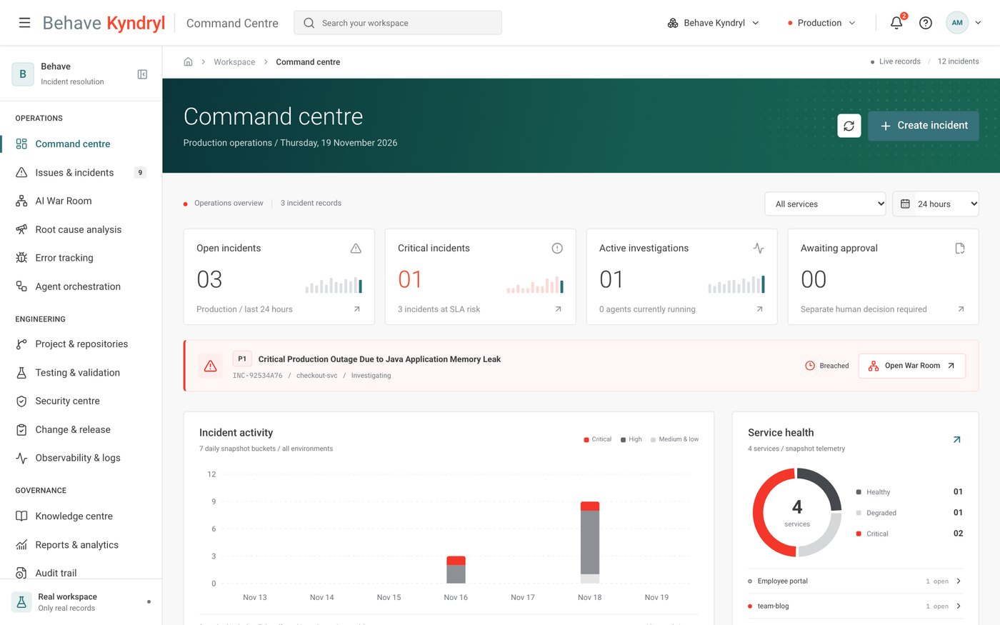
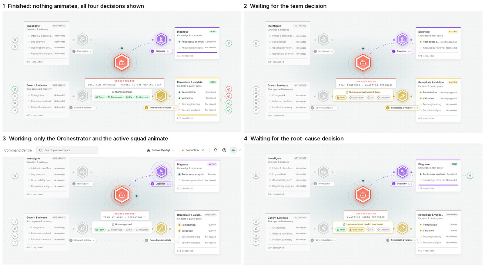
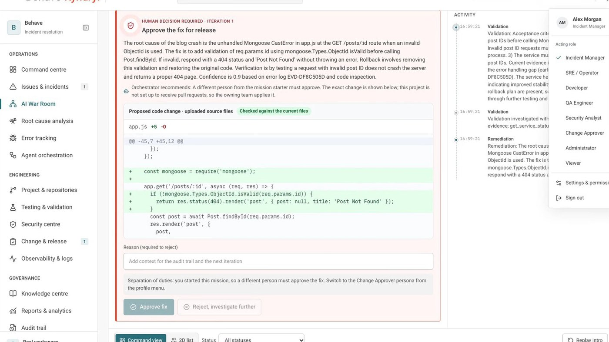

# Behave Kyndryl

**Your Problem. Their Mission.** When something breaks in production, an Orchestrator agent and 13 specialist agents on **Azure AI Foundry** investigate the real logs and code, name the root cause with evidence, and write the exact fix. **People approve every step**, a second person approves every fix, and every change is **measured on the running service** before an incident is called resolved.

**Team HacKyn** · Agentic AI Kyndryl U.S. Hackathon · Use case theme: Application Managed Services (AMS)

| | |
|---|---|
| **Live proof of concept** | **https://behave-kyndryl.happyglacier-e926a380.westus3.azurecontainerapps.io** (no sign-in needed) |
| **Measured in our recorded run** | 80 s from incident report to measured recovery · failed requests **10% → 0%** under 50 concurrent users |
| **Built on** | Azure AI Foundry Agent Service · Azure OpenAI (two model tiers) · Azure AI Search · Azure Container Apps · Entra ID · Key Vault · Application Insights |
| **Quality** | 206 automated tests (185 backend, 8 Payment API, 13 browser) · Google Lighthouse 100 performance and 100 accessibility, desktop and mobile |



---

## For evaluators: see it working in 10 minutes

Open the live site. You arrive signed in as **Alex Morgan, Incident Manager**. Your role is shown at the top right (**AM**); click it and choose **Acting role** to switch, for example to **Change Approver**. Nothing to install.

The two sample files used below are in this repository: [`samples/blog-incident/`](samples/blog-incident/) (a small Node.js blog as a ZIP, and its crash log).

### Walkthrough 1: a real crash, from report to an approved fix (about 6 minutes)

1. **Report the incident.** On **Command centre**, click **Create incident**. Give it a title (e.g. *Blog crashes when someone opens a wrong post link*), the service `team-blog` and severity *High*.
   Under source code choose **Project ZIP** and select `blog_web_app.zip`; under evidence choose **Error logs** and select `blog-error.log`. Create it.
   *What to notice:* the ZIP is inspected in memory and never unpacked or run; the language and framework are detected.
2. **Error tracking** (left menu). The crash is grouped as **one error that happened twice** and traced to **`app.js` line 49**.
3. **AI War Room.** Select your incident and click **Start agent mission**. The **Orchestrator** proposes a team (typically 3 of the 13 specialists) and **explains why each agent was chosen or left out**. Click **Approve team**.
4. The agents investigate with **read-only tools**; every tool call appears in the activity feed. They agree a **root cause with evidence IDs and a confidence score**. Click **Approve root cause**.
5. **The fix gate.** The remediation agent returns an **exact code change, checked against the real file** and shown as a diff. Try **Approve fix** as Alex: it is refused, because the person who started the mission cannot approve its fix. Switch the acting role to **Change Approver** and approve it.
6. **The outcome.** The platform did not run this code, so the last gate offers **Hand over the solution**: the approved change goes to the owning team and the mission ends as *Solution ready*, never as "Resolved". Agents never merge or deploy. Open **Incident report** to preview the report and **Download PDF**.
7. **Organisational memory.** **Knowledge centre → Drafts**: the resolution record waits for a different person to approve it; approved records are indexed in **Azure AI Search** and recalled when the same error returns.

### Walkthrough 2: a governed change, measured on a running service (about 3 minutes)

1. **AI War Room**: select the incident on the **Payment API sandbox** service (*Payment summary endpoint failing after v3.8.1 release*). In the sandbox panel click **Start sandbox**, then **Run workload**: 50 simultaneous requests, and about **10% fail** (a database pool of 5).
2. Click **Start agent mission** and approve the team and the root cause as before; approve the fix as **Change Approver**.
3. The approved change (pool 5 → 20) is applied **only through the Tool Gateway**, which checks the stored approval and the SHA-256 of the change again and runs it **exactly once**. The workload is re-run: **0 failures**. Only now does the last gate offer **Confirm resolved**.
4. **Change & release** shows the gateway log: who approved, what ran, once.

### Also worth a look

| Where | What it shows |
|---|---|
| **Agent orchestration** | All 14 agents, their squad, their model tier (advanced reasoning or fast) and what each is doing |
| **Administration → Foundry agents** | The 14 versioned agents in Azure AI Foundry and their status |
| **Audit trail** | Who did what and when, for every decision |
| **Help (?) → API reference** | Every endpoint, with **Test live** to call it on the running service |
| **On a phone** | The same workspace, missions and approvals; the site is fully responsive |

*The live site is shared by every visitor: three administrative actions (re-creating the Foundry agents, clearing the workspace, changing policy) are turned off there, and AI calls have a daily budget. Everything else works.*



---

## Where each evaluation criterion is answered

| Criterion | What to look at | In the code |
|---|---|---|
| **Business value and impact** | Walkthrough 2 (10% → 0%, measured); the savings model below | `backend/mission.py`, `payment_api/` |
| **Innovation and originality** | A team formed per incident, with reasons; fixes checked against real files; a gateway that re-checks every approval | `backend/foundry_brain.py`, `backend/tool_gateway.py` |
| **Technical architecture** | 14 Foundry agents on two model tiers, one Container App, keyless access | `backend/foundry_agents.py`, `backend/model_tiers.py`, `deploy/` |
| **Agentic design** | Perceive → Reason → Plan → Act → Learn; 13 read-only tools; schema-checked answers | `backend/investigation_tools.py`, `backend/foundry_runtime.py` |
| **Security and responsible AI** | Four human gates, separation of duties, no write tools for agents, secrets redacted before any AI call | `backend/domain.py`, `backend/data_governance.py`, `backend/tool_gateway.py` |
| **Working prototype** | The live site and both walkthroughs | everything |
| **Quality** | 206 tests; the backend tests, lint and build gate every deploy; Lighthouse scores | `backend/tests/`, `payment_api/tests/`, `tests/`, `.github/workflows/deploy.yml` |

---

## How it works

```
People (Entra ID or judge mode)
   │
   ▼
Azure Container Apps: one container ───────────────────────────────────────────────
   React 19 web app  →  REST API /api/v1 (FastAPI)  →  Mission engine
                                                         │  plan → human gates → steps → measure → learn
                       ┌─────────────────────────────────┼──────────────────────────────┐
                       ▼                                 ▼                              ▼
          Azure AI Foundry Agent Service        Tool Gateway (the only way out)   Azure AI Search
          Orchestrator + 13 specialists          GitHub pull request, or           approved resolutions
          advanced model: 6 · fast model: 8      Payment API sandbox change        (organisational memory)
                       │
          13 read-only tools: tickets, evidence, logs, service status, changes, repository files, knowledge
───────────────────────────────────────────────────────────────────────────────────────
Managed identity (no keys in code) · Key Vault · Application Insights traces · Azure Files (database)
GitHub Actions with OIDC: tests → build image → new revision → health check
```

**The 14 agents and their model tier**

| Squad | Agents | Model tier |
|---|---|---|
| Lead | **Orchestrator**: reads the ticket, picks the team, plans, reviews | Advanced reasoning |
| Investigate | Intake and classification · Log analysis · Observability · Repository analysis | Fast |
| Diagnose | **Root-cause analysis** · Knowledge retrieval | Advanced · Fast |
| Remediate and validate | **Remediation** · **Security analysis** · **Validation** · Test engineering | Advanced · Fast |
| Govern and release | **Change risk** · Release coordination · Incident summary | Advanced · Fast |

The six agents that make decisions run on the advanced reasoning model; the eight that gather and summarise run on a fast, low-cost model (`backend/model_tiers.py`). The site shows the tier, never a deployment name.

**Four human gates:** approve the team, approve the root cause, approve the fix (a **different person** from the one who started the mission), confirm the outcome. A root cause with confidence below 0.6 can never become a fix. An incident is *Resolved* only when a change was applied and measured.

More detail: [docs/architecture.md](docs/architecture.md). Sample incident reports produced by the app: [docs/sample-reports/](docs/sample-reports/).

---

## Business value

Measured: 80 seconds from report to measured recovery in our recorded sandbox run, with every decision on record.

Estimated, with the assumptions stated so a pilot can replace them: 100 incidents a month × 4 engineer-hours each × 30% of the work done by the agents × $60 an hour ≈ **$7,200 saved a month**, for a platform cost of about **$70 a month** on Azure (agent spend capped daily).

---

## Run it locally

**You need** Node.js 20+ and Python 3.12+. No Azure account is needed: without Azure settings, missions run on a free **simulated planner** that is clearly labelled as such.

```bash
# 1. Install
npm ci
python3 -m venv .venv
.venv/bin/python -m pip install -r backend/requirements.txt
#    Windows: .venv\Scripts\python.exe -m pip install -r backend\requirements.txt

# 2. Configure (optional; the app runs without changes)
cp .env.example .env
#    Windows: Copy-Item .env.example .env

# 3. Run, in two terminals
.venv/bin/python -m uvicorn backend.app:app --host 127.0.0.1 --port 8000
npm run dev -- --host 127.0.0.1 --port 5173
```

Open **http://127.0.0.1:5173**. The interactive API docs are at http://127.0.0.1:8000/api/docs.

### Use the real agents (optional)

Add your Azure AI Foundry project to `.env` (never commit it; `.env` is git-ignored), sign in, and create the agents:

```bash
# .env
# AZURE_AI_PROJECT_ENDPOINT=https://<resource>.services.ai.azure.com/api/projects/<project>
# AZURE_AI_MODEL_DEPLOYMENT=<fast model deployment>
# AZURE_AI_MODEL_DEPLOYMENT_ADVANCED=<advanced reasoning model deployment>   (optional; without it every agent uses the fast model)

az login                                        # an account with the "Azure AI User" role on the project
.venv/bin/python -m backend.foundry_provision   # creates or updates the 14 agents (safe to re-run)
```

Restart the backend: missions then show **AI-GENERATED** and run on the Foundry agents. **Administration → Foundry agents** shows each agent's status.

### Connect a GitHub repository (optional)

One entry in `projects.json` connects a project, with no change to the project itself:

```json
{ "service": "employee-portal", "name": "Employee portal",
  "code": { "type": "github", "repo": "owner/repository", "ref": "main", "path": "" } }
```

Private repositories need a read-only token in `AGENTICA_GITHUB_TOKEN` (environment only). With `"pull_requests": true`, an approved fix is pushed to a new `behave/<incident>-<mission>` branch as a pull request; nothing is ever merged.

---

## Tests

```bash
npm run typecheck
npm run lint
DATABASE_URL=sqlite:///:memory: AGENTICA_MODE=demo .venv/bin/python -m pytest backend/tests payment_api/tests -q
npm run test:e2e        # builds the site, then runs the browser tests
```

The tests never call Azure: they use the simulated planner and a stand-in AI client. One test starts the real Payment API process and checks the failure and the recovery. To run one real mission against your Foundry agents: `RUN_LIVE_FOUNDRY=1 .venv/bin/python -m pytest backend/tests/test_live_foundry.py -s` (costs a few cents).

---

## Deploy to Azure

`az login`, then `./deploy/azure/deploy.sh` (safe to re-run) creates the Container App, registry, storage, managed identity and Foundry access. `./deploy/azure/github-oidc.sh` connects GitHub Actions once; after that every push to `main` runs the tests, builds the image and rolls out a health-checked revision (`.github/workflows/deploy.yml`). GitHub holds no Azure password.

---

## Repository layout

| Path | What's there |
|---|---|
| `src/` | React 19 + TypeScript web app: 14 workspace pages, the AI War Room, API reference |
| `backend/` | FastAPI app, mission engine, Foundry agents and runtime, Tool Gateway, connectors, PDF reports |
| `backend/tests/`, `payment_api/tests/`, `tests/` | Backend (pytest) and browser (Playwright) tests |
| `payment_api/` | The Payment API sandbox service and its workload generator |
| `sample_services/` | Synthetic logs and code for the demo services |
| `samples/blog-incident/` | The project ZIP and crash log used in Walkthrough 1 |
| `deploy/` | Container image and Azure deployment scripts |
| `docs/` | Architecture notes, screenshots and sample incident reports |

---

## Honest limits

- Proof of concept: a single workspace with demo personas; roles come from the app (mapping Entra groups to roles is next), and there is no multi-tenancy yet.
- Uploaded code is never executed (there is no isolated test runner yet), so no build or test result is claimed for it.
- Connectors today: GitHub repositories, uploaded files and ZIPs, local log folders and the sandbox log. ServiceNow, Jira, Log Analytics and Splunk are next.
- The only changes the platform can make are a GitHub pull request (opt-in per project) and the Payment API sandbox setting, each after a separate human approval.



---

**Team HacKyn:** K S Rakul (team leader) · Harshavardhan S U · Vikram · Srinidhi P · Thanishtha J
