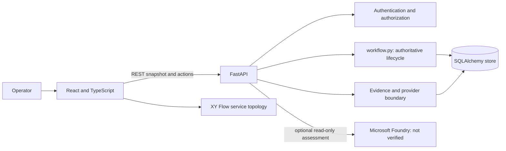
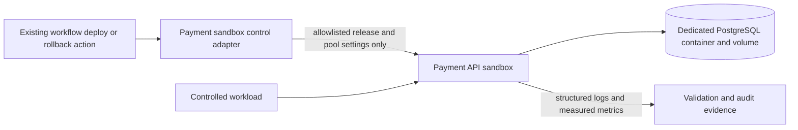

# BEHAVE KYNDRYL Architecture

Audit date: 2026-11-03. This document distinguishes the verified local application from the staged target. The current repository is the source of truth; no presentation deck was present in the inspected repository.

## Current System

| Boundary | Current implementation | Authority and limitation |
| --- | --- | --- |
| Web client | React 19, TypeScript, Vite; routed command centre and 13 operational modules. | Reads a backend workspace snapshot through React Query. |
| Service topology | XY Flow graph in the AI War Room. | Existing topology visualization; not an agent workforce and must remain XY Flow. |
| API | FastAPI application and routes in `backend/app.py`; validated Pydantic contracts in `backend/domain.py`. | Authenticates demo sessions locally and validates Entra JWTs in production mode. |
| Persistence | SQLAlchemy JSON-backed workspace/entity/audit/session tables in `backend/store.py`. | SQLite is the local default. PostgreSQL is a production configuration requirement, not an exercised deployment. There is no versioned migration system or tenant row isolation. |
| Lifecycle | `backend/workflow.py`. | Sole authority for the 17 incident actions, state changes, approval checks and current synthetic demo workflow. |
| Specialist identities | `backend/seed.py`. | Fourteen named logical roles and static demo task records; no dynamic planner or specialist execution pipeline exists. |
| Provider | `backend/providers.py`. | Optional, read-only Microsoft Foundry assessment; a configured endpoint is not a verified connection. No credentials/connectivity were verified. |
| Evidence controls | `backend/data_governance.py` and evidence routes. | Validation, redaction, sensitivity and provenance metadata exist. No malware scanning, external object store, comprehensive classification authorization or retention enforcement. |
| UI updates | React Query snapshot polling. | 1.2-second polling during a running workflow, otherwise 30 seconds. No durable domain-event sequence, replay, SSE or WebSocket. |

## Stage 1A Target Boundary

Stage 1A adds an isolated Payment API operational sandbox alongside the existing application. It must not change the main application's local SQLite configuration or route the sandbox control adapter to an unapproved environment.

The sandbox adapter owns `set_release`, `set_pool_size`, `restart`, and `get_active_config`. It validates the one approved service/environment, emits audit evidence, verifies active configuration, and never falls through to a production deployment service. The implemented previous release has pool size 20 and omits `GET /payments/summary`; v3.8.1 has pool size 5 and implements that endpoint against sandbox data. These release behaviors are not runtime-verified until the Docker acceptance gate passes.

The Stage 1A code is now present. `backend/payment_sandbox.py` invokes only the fixed `behave-payment-sandbox` Compose project and `payment-api` service; the workflow persists an operation intent before invoking it, then records the verified adapter result. A previous-release image is built under the `release-build` profile. The adapter runs from the existing BEHAVE backend process on the host; this avoids granting the backend container broad Docker-socket access. The Compose stack intentionally contains only the sandbox and PostgreSQL services. Runtime execution, three-run acceptance and owner verification remain `NOT RUN` because Docker is unavailable in the current environment.

The Compose stack must give the Payment API its own PostgreSQL database, environment configuration, health checks and persistence. A comparative rollback clone must later use a distinct Compose project, database, ports, volumes, configuration and adapter; that clone belongs to Stage 3, not Stage 1A.

## Orchestration Decision

`backend/workflow.py` remains the sole lifecycle engine. The current code already owns action validation, authorization, idempotency, state transitions and approval separation. The Stage 1A adapter will be invoked from its governed deploy/rollback branches only for the explicitly allowlisted Payment API sandbox. It will not introduce a second lifecycle or silently replace existing demo semantics for other services.

Stage 1B adds a deterministic input-derived planner for the mock provider, validated specialist contracts, read-only operational tools, persisted event records and event delivery. A live provider planner may be added behind the same contract after explicit configuration and connection verification. Neither planner may authorize or execute its own recommendations.

## Target Trust Boundaries

- The authenticated backend resolves identity, authorization and tenant context; clients never supply authoritative tenant identity.
- Uploaded logs, repository fixtures and tool outputs are untrusted data, not instructions.
- Investigation tools are read-only. Only the sandbox control adapter can apply the approved Payment API release/pool changes.
- Approval is bound to the exact action and payload and must be performed by a distinct authorized human.
- Each control operation and approval is audited. A successful configuration call is not proof of recovery; independent workload validation is required.
- Provider egress is classification-allowlisted. Restricted data remains blocked unless separately approved controls are implemented.
- `REAL`, `MEASURED`, `SIMULATED`, `SYNTHETIC`, `ESTIMATED`, `AI-GENERATED`, `DETERMINISTIC`, and `NOT CONFIGURED` must retain their specified meanings.

## Deployment and Readiness

Podman-native `Containerfile`, `compose.yaml`, `.containerignore`, and a pinned `podman-compose` provider are now present for the isolated sandbox. Podman 5.8.1 is reachable, but sandbox images have not built: the configured external registry currently fails certificate verification. No Docker CLI or Docker engine is used by the sandbox path. Azure deployment, live cloud resources, tenant isolation, migrations and production operations remain unconfigured; no production-readiness claim is made.